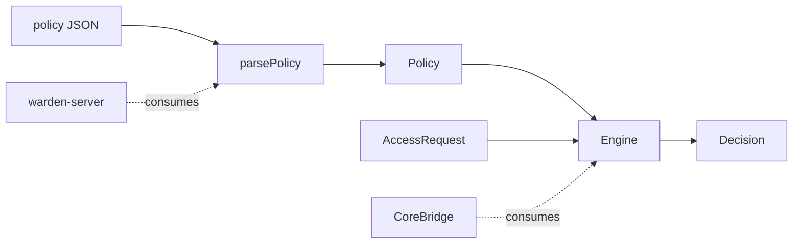

# warden-core

Cross‑platform C++17 rule engine of **Warden**, a lightweight Endpoint DLP, shared by the macOS agent and the Windows server. Also hosts the shared repository tooling (`tooling/`); design tokens are planned (coming in a following PR).

Design: [warden-macos/docs/superpowers/specs/2026-10-20-warden-design.md](https://github.com/EugeneHil/warden-macos/blob/develop/docs/superpowers/specs/2026-10-20-warden-design.md)


## Repository layout

| Path | Contents |
| --- | --- |
| `include/warden/` | Public C++17 API: `policy.hpp`, `policy_parser.hpp`, `engine.hpp`, `path.hpp`, `glob.hpp`, `version.hpp` |
| `src/` | Implementation of the `warden_core` static library |
| `tests/` | GoogleTest suites (`*_test.cpp`), `alloc_test.cpp` (allocation-free guarantees), `test_support.hpp` |
| `scripts/` | `lint.sh`, `coverage.sh`, `coverage_gate.py` |
| `tooling/` | Shared repository tooling (Claude guard hook, GitHub bootstrap and workflows) |
| `docs/adr/` | Architecture decision records |

## Build

Requires CMake 3.25+ and a C++17 compiler. Presets: `macos` and `windows` are built in CI, `linux` is defined but unverified, `coverage` is used by `scripts/coverage.sh`.

```sh
cmake --preset macos
cmake --build --preset macos
```

## Test

```sh
ctest --preset macos --output-on-failure
```

## Lint

```sh
scripts/lint.sh   # clang-format and clang-tidy, warnings are errors
```

## Coverage

```sh
scripts/coverage.sh   # fails below 90 % line coverage
```

## Architecture



`warden-server` uses the parser and validator; the macOS agent reaches `Engine` through `CoreBridge`.

## Public API

- `parsePolicy(json)` parses and validates a policy document. It reports every error found as a `ValidationError` (a `path` such as `rules[0].targets[1]` plus a `message`; `$` is used only for document-level errors, and an unknown root-level key is reported at the key name), never throws except `std::bad_alloc`, and returns a `Policy` only when there are no errors. Duplicate object keys are errors (`<object path or $>: duplicate key '<k>'`). Input nested deeper than 64 levels is rejected with `$: nesting too deep`. `describe(error)` formats an error as `<path>: <message>`.
- `Engine(Policy)` is an immutable evaluator and safe to share across threads. `evaluate(request)` normalizes the file path, then returns the first rule that denies, as `Decision{Verdict::Deny, ruleId}`. Otherwise it returns `Verdict::Allow` with an empty `ruleId`. A free `evaluate(policy, request)` is equivalent.
- `Engine::isPotentiallyProtected(path)` is a conservative, allocation-free, `noexcept` prefilter: it never returns `false` for a path that `evaluate` could deny, but may return `true` for paths that end up allowed.
- `matchesProcess`, `normalizePath`, `isCanonicalPath`, `expandTarget`, `globMatch` and `globError` expose the building blocks.

## Policy semantics

- A rule denies when one of its `targets` globs matches the normalized file path and one of its `processes` matchers matches either the accessing process or its responsible process.
- Rules are evaluated in order; the first denying rule wins. If none matches the request is allowed.
- A process matcher is a logical AND of its present fields (`teamId`, `signingId`, `signingIdPrefix`, `path`). A matcher with no fields never matches, and an empty `ProcessInfo` value never matches a present field.
- Paths are normalized lexically: `//` collapsed, `.` dropped, `..` resolved (never above root), trailing `/` dropped, and `/tmp`, `/var`, `/etc` rewritten to `/private/...`.
- Target globs: `*` matches any run of characters within one segment, `**` matches zero or more whole segments, a pattern without a leading `/` (such as `**/.env`) matches at any depth, and `~` expands to `/Users/*`.

## Known limitations

- Matching is case-sensitive.
- `~` covers `/Users/*` only (not `/var/root`); it also matches `/Users/Shared`.
- Targets whose first segment is a wildcard (such as `/*/secret`) never match alias paths like `/tmp/secret`, whose canonical form is `/private/tmp/...`.
- Process matcher `path` values must be canonical (no `.`, `..`, `//`, trailing `/`, or `/tmp`, `/var`, `/etc` alias prefix); use `/private/tmp/...` form.
- The free `evaluate()` copies and recompiles the `Policy` on every call; use `Engine` in hot paths.
- `Engine` expects policies that were validated by `parsePolicy`; hand-built policies are not re-validated.
- `std::bad_alloc` can propagate from the parser and the engine.

## Roadmap

- Case-insensitive matching
- `/var/root` home directory support
- Content-based rules
- Linux in CI
- Richer matchers
- Design tokens, coming in a following PR
